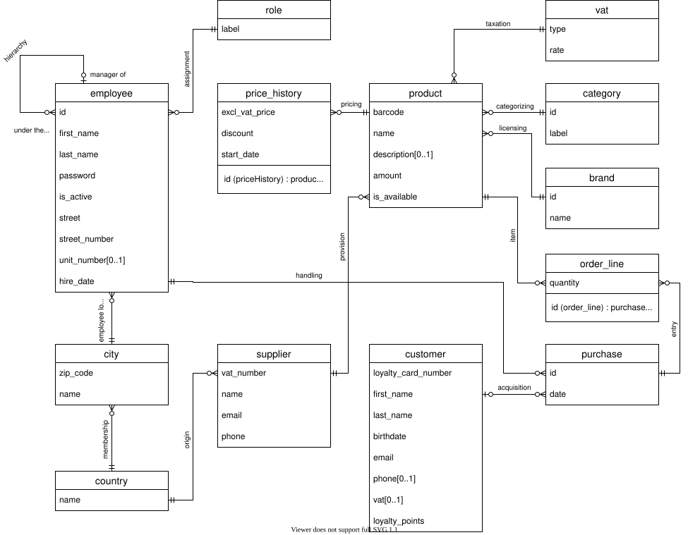
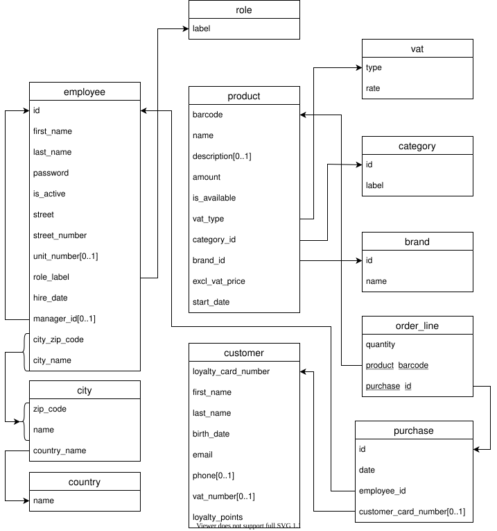

<div align="center">
    
    <h1>Le P'tit Bazar</h1>
</div>

Un logiciel de gestion, réalisé en Java avec Swing et SQL avec Postgres, permettant la régie de magasins d'alimentation généralistes. Il traite les stocks, les clients (fidélité, etc) et les employés.

## Feuille de route

Une feuille de route avec les fonctionnalités à implémenter et leur avancement [ici](roadmap.md).

## Table des matières

1. [Feuille de route](#feuille-de-route)
2. [Table des matières](#table-des-matières)
3. [Installation](#installation)
   - [Prérequis](#prérequis)
   - [Build](#build)
4. [Technologies utilisées](#technologies-utilisées)
   - [Développement](#développement)
   - [Dépendances](#dépendances)
   - [Interface utilisateur](#interface-utilisateur)
   - [Base de données](#base-de-données)
   - [Modélisation](#modélisation)
5. [Structure de la base de données](#structure-de-la-base-de-données)
6. [Informations sur la licence](#informations-sur-la-licence)

## Installation

### Prérequis

- Java 11 ou supérieur (JDK)
- Docker (pour la base de données)

### Build

1. **Cloner le dépôt**

   ```bash
   git clone https://github.com/maxoux53/petit-bazar.git
   cd petit-bazar
   ```

2. **Configurer les variables d'environnement**  
   Configurer les variables :
   - `PG_USER`: Nom d'utilisateur pour la base de données
   - `PG_PASSWORD`: Mot de passe pour la base de données
   - `PG_DB`: Nom de la base de données
   - `STORE_NAME`: Nom du magasin (affiché dans l'interface graphique)

   Possibilité d'utiliser le [fichier d'exemple `.env`](./example.env). Le renommer en .env et modifier les valeurs comme souhaité.

3. **Configuration de la base de données**
   - Utiliser la commande compose pour créer le conteneur PostgreSQL

      ```bash
      docker compose up -d
      ```

4. **Lancer l'application**
   - Ouvrir le projet dans IntelliJ
   - Lancer la classe `Main` pour démarrer l'application

   Possibilité de compiler le projet soi-même avec `javac`.

## Technologies utilisées

### Développement

- Java
- OpenJDK
- Système de build IntelliJ

### Dépendances

- [Dotenv](https://github.com/cdimascio/dotenv-java)
- [Pilote JDBC PostgreSQL](https://github.com/pgjdbc/pgjdbc)

### Interface utilisateur

- JFC Swing
- AWT

### Base de données

- PostgreSQL
- Docker
- DataGrip & Azure Data Studio (pour le développement)

### Modélisation

- Draw.io (entité-association et relationnel)

## Structure de la base de données

> [!IMPORTANT]
> Schémas uniquement visibles avec l'interface en **thème clair** !

**Schema entité-association (EA)**  


**Schema relationnel**  


## Informations sur la licence

### Contributions et crédits

Ce projet a été réalisé par [Constant B.](https://github.com/Zencaaw/), [Adrien D.](https://github.com/Tropicooooo/) et [Max N.](https://github.com/maxoux53/) dans le cadre du cours de Programmation orientée objet avancée (IG252).  
Nom inspiré de l'illustre [Grand Bazar](https://github.com/Tisdax/grand-bazar) par Tisdo.

### Licence

*Ce projet est sous licence GNU GPL v3. Pour plus de détails, veuillez consulter le fichier [LICENSE](LICENSE).*
